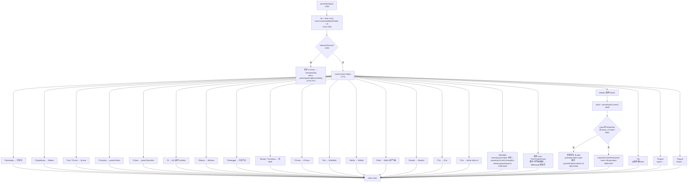
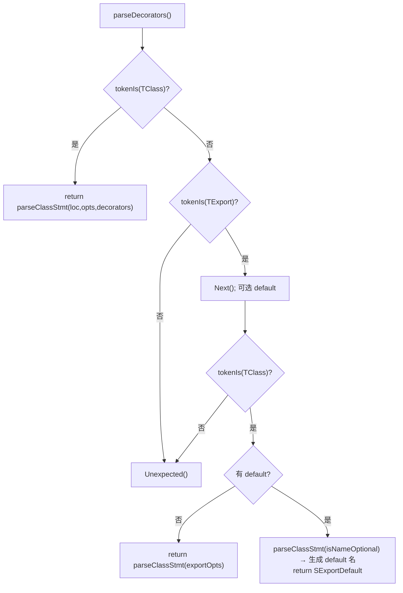
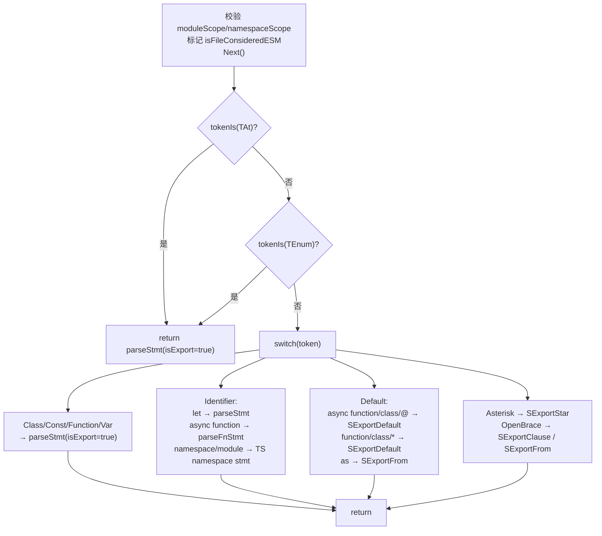
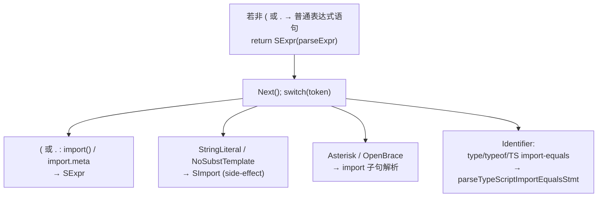
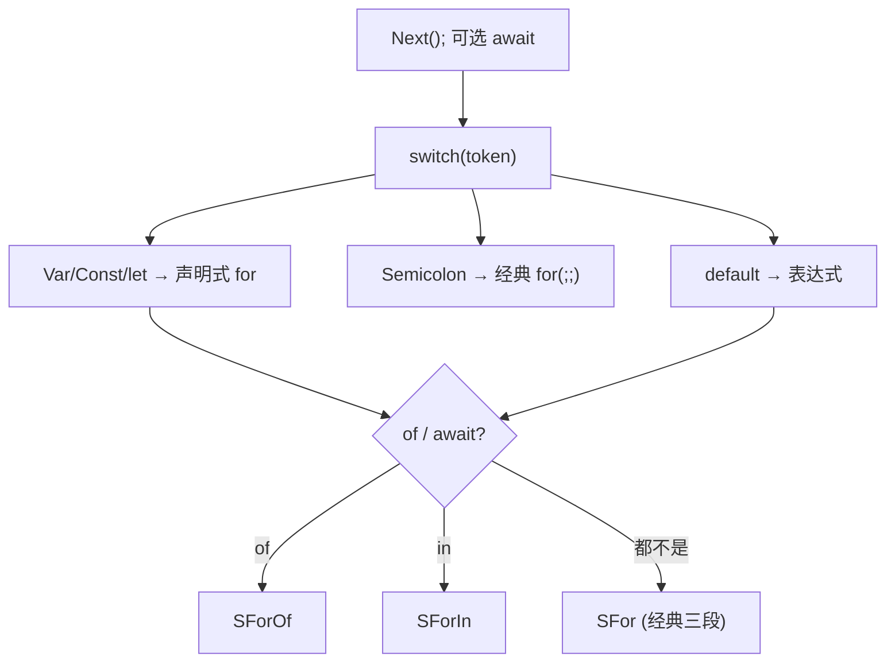

# parseStmt 控制流程图

来源：`src/internal/js_parser/js_parser.ts:4760-5847`（`parseStmt(opts: parseStmtOpts): js_ast.Stmt`）。
语义对应 Go：`internal/js_parser/js_parser.go:7108` 起。以下行号已用 grep 核对（2026-11-21）。

## 主流程（入口 → switch 分派 → 汇合）

## 三个大分支的内部结构

### TAt（`@` 装饰器）`:4775-4813`

### TExport（`:4814-5056`）—— 结构最深的分支

### TImport（`:5057-5264`）

### TFor（`:5602-5785`）—— 三路消歧

> 注：TFor 子 switch 的 case 在 `:5632`(Var) / `:5642`(Const) / `:5651`(Semicolon)，default 表达式分支在其后。

## 关键观察（性能视角）

- `parseStmt` 是**一个约 1090 行的大函数**，主体是对 `lexer.Token` 的巨型 switch（20+ case），其中 export/import/for 三个 case 各自又嵌套子 switch 与多次 `parseStmt` 递归。
- 递归再进入 `parseStmt` 的入口有 6+ 处（export 转发、if 的 yes/no、label 体、block 内语句等），这是 inclusive% 远超 100% 的原因。
- 多数 case 的落点是「消费 token → 调 `parseExpr`/`parseFnStmt`/`parseClassStmt` → 包一个 `S*` AST 节点 → return」。
- default 与所有「非语句开头」token 汇合到表达式语句路径（`parseExpr(LLowest)` + 可能的标签消歧 + 分号）。
- `TIdentifier` case 先做 namespace/module 前瞻消歧，再调 `parseExprOrLetOrUsingStmt`（:5810）；返回 null 才 fallthrough 到表达式语句。
